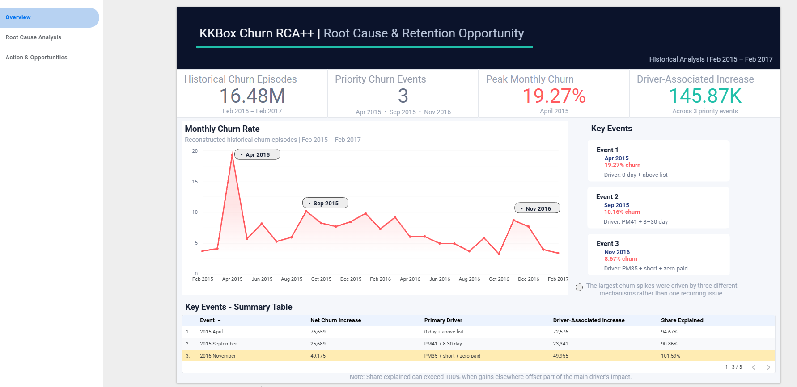
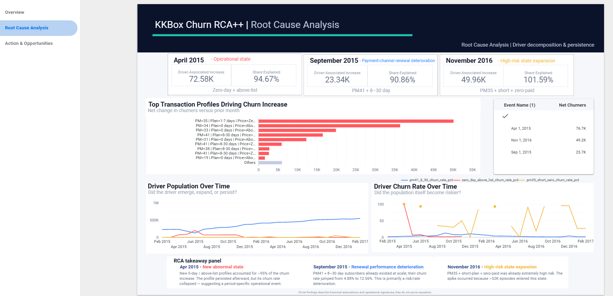
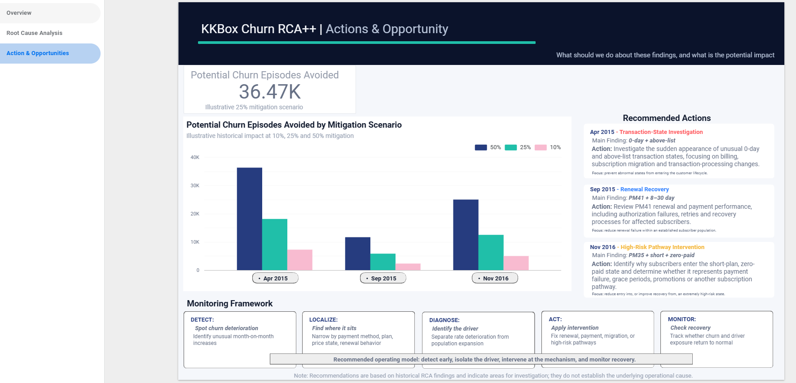

# KKBox Churn RCA++

## Root Cause Analysis + Predictive Churn Risk Case Study

An end-to-end analytics case study using the KKBox churn dataset to answer two complementary business questions:

> **Why did churn deteriorate historically?**

> **Which subscribers are most likely to churn next?**

The project combines root-cause analysis, executive dashboarding, predictive modelling, out-of-time validation, and model explainability.

---

## Project Overview

The analysis follows this decision flow:

**Detect → Localize → Diagnose → Size → Recommend → Predict → Explain**

Rather than treating churn as a single modelling problem, the project separates:

- **Root Cause Analysis** — understanding what changed at population level
- **Predictive Modelling** — prioritising individual subscribers by future churn risk

---

# 1. Executive Churn Analysis

Historical churn episodes were reconstructed from transaction behaviour between February 2015 and February 2017.

Three major deterioration periods were selected for deeper analysis:

| Event | Churn Rate | Primary Pattern |
|---|---:|---|
| April 2015 | **19.27%** | New zero-day / above-list subscription states |
| September 2015 | **10.16%** | PM41 + 8–30 day renewal deterioration |
| November 2016 | **8.67%** | Expansion of PM35 + short-plan + zero-paid state |

Across these events, the primary driver populations were associated with approximately **145.9K additional churn episodes**.

---

## Dashboard — Executive Overview

The first page answers:

> **What happened, when, and how large was the deterioration?**

It highlights:

- 16.48M historical churn episodes analysed
- three priority churn events
- peak monthly churn of 19.27%
- driver-associated churn increase
- monthly churn trend
- event-level sizing

---

# 2. Root Cause Analysis

The three churn spikes looked similar at aggregate level but were driven by different mechanisms.

### April 2015 — New Subscription-State Anomaly

A new family of zero-day and above-list transaction states appeared at scale.

The primary driver accounted for approximately:

- **72.6K additional churn episodes**
- **94.7% of the overall churn increase**

The state remained present afterward, but its churn rate declined sharply, suggesting a period-specific operational or subscription-state issue rather than a permanently high-risk population.

---

### September 2015 — Renewal Risk Deterioration

The PM41 + 8–30 day population already existed at significant scale.

Its churn rate increased from approximately:

**4.88% → 12.56%**

The primary driver accounted for:

- **23.3K additional churn episodes**
- **90.9% of the overall increase**

This represents deterioration within an established renewal/payment population.

---

### November 2016 — High-Risk State Expansion

A PM35 + short-plan + zero-paid state had already demonstrated high churn risk historically.

In November, approximately **52K subscription episodes** entered the state, with a churn rate of about **95.8%**.

This was primarily a **population expansion into an already high-risk state**.

---

## Dashboard — Root Cause Analysis

The RCA distinguishes between:

- new abnormal states
- worsening risk within an existing population
- expansion of a known high-risk population

This distinction is important because each mechanism requires a different intervention.

---

# 3. Actions & Opportunity

Historical scenario sizing was used to estimate the scale of potential mitigation.

| Mitigation Scenario | Potential Churn Episodes Avoided |
|---|---:|
| 10% | ~14.6K |
| 25% | ~36.5K |
| 50% | ~72.9K |

These figures are illustrative historical scenarios, not forecasts or guaranteed retention outcomes.

Recommended action areas included:

- investigation of unusual subscription and transaction states
- payment and renewal recovery
- intervention on high-risk subscription pathways
- recurring churn monitoring

---

## Dashboard — Actions & Opportunity

The operating framework is:

**Detect → Localize → Diagnose → Act → Monitor**

---

# 4. Predictive Churn Modelling

The project was extended from historical diagnosis into subscriber-level churn prediction.

A point-in-time-safe design was used:

### Development cohort

- February 2017 churn cohort
- feature cutoff: **31 January 2017**
- churn rate: **6.39%**

### Out-of-time holdout

- March 2017 churn cohort
- feature cutoff: **28 February 2017**
- churn rate: **8.99%**

Only information available at or before the relevant prediction cutoff was used.

---

## Feature Engineering

Features included:

- transaction recency
- transaction frequency over 30 / 90 / 180-day windows
- cancellation behaviour
- auto-renew behaviour
- payment-method stability
- latest subscription state
- pricing behaviour
- expiry timing
- subscriber tenure
- member profile attributes and missingness

Future transactions and other post-cutoff information were excluded.

---

# 5. Model Comparison

Three modelling levels were evaluated.

| Model | ROC-AUC | PR-AUC | Top-10% Capture | Top-10% Lift |
|---|---:|---:|---:|---:|
| Dummy | 0.5000 | 0.0639 | 9.70% | 0.97× |
| Logistic Regression | 0.8558 | 0.4998 | 64.83% | 6.48× |
| **Gradient-Boosted Trees** | **0.8956** | **0.5627** | **67.61%** | **6.76×** |

The gradient-boosted tree model was selected for final evaluation.

---

# 6. Final Out-of-Time Performance

The selected model was retrained on the full development cohort and evaluated once on the later holdout.

Final performance:

- **ROC-AUC:** 0.8711
- **PR-AUC:** 0.5914
- **Top-10% churn capture:** 60.34%
- **Top-10% lift:** 6.03×

This means:

> If retention capacity covered only the highest-risk 10% of subscribers, the model would identify approximately **60% of actual churners** in the later cohort.

---

# 7. Model Explainability

Model-agnostic permutation SHAP was used to explain predicted churn probabilities.

The explanation method was validated to ensure that:

> **baseline probability + feature contributions = model prediction**

Key global predictive signals included:

- auto-renew status
- cancellation status
- transaction history
- payment method
- recent transaction activity
- transaction recency
- subscription and expiry state

A feature-ablation test also confirmed that model performance was not dependent on a single expiry-related feature family.

SHAP values are used to explain model behaviour and are not interpreted as causal effects.

---

# 8. Business Interpretation

The project demonstrates that churn analytics benefits from combining two different approaches.

### Root Cause Analysis

Answers:

> **What changed, where, and why should the business investigate it?**

### Predictive Modelling

Answers:

> **Which subscribers should be prioritised for retention activity?**

Together they support a fuller decision process:

**Diagnose the problem → design the intervention → prioritise who to act on**

---

# Technology

- Python
- Pandas
- DuckDB
- PyArrow / Parquet
- scikit-learn
- SHAP
- Matplotlib
- Jupyter
- Looker Studio
- Git

---

## Selected Code Samples

The public repository includes several curated technical excerpts:

- [`feature_engineering_sample.py`](code_samples/feature_engineering_sample.py) — point-in-time-safe behavioural feature engineering
- [`model_evaluation_sample.py`](code_samples/model_evaluation_sample.py) — ROC-AUC, PR-AUC, capture and lift evaluation
- [`shap_validation_sample.py`](code_samples/shap_validation_sample.py) — validation of model explanation additivity

The full development notebooks and intermediate pipelines remain in the private working repository.

# Repository Scope

This public repository is a curated portfolio case study.

It contains:

- project methodology and findings
- selected code samples
- dashboard screenshots
- model and RCA results

It intentionally does not redistribute:

- the original KKBox dataset
- full working notebooks
- intermediate analytical datasets
- complete private development artifacts

The source dataset should be obtained from the original KKBox churn prediction challenge.

---

# Limitations

- Historical churn reconstruction does not perfectly reproduce the original competition label snapshot.
- RCA findings represent historical associations and operational signatures, not proven causal mechanisms.
- Member demographic data contains substantial missingness.
- Predictive performance may drift as customer behaviour or subscription processes change.
- SHAP explains model behaviour rather than causal relationships.
- Mitigation scenarios are illustrative historical sizing exercises rather than guaranteed future outcomes.

---

## Summary

This case study demonstrates an analytics workflow that moves beyond reporting churn rates toward:

**detecting deterioration, isolating drivers, sizing impact, recommending action, predicting future risk, and explaining model behaviour.**

## Usage

This repository is shared as a personal portfolio case study.  
Please do not reproduce or republish the analysis or code as your own work.